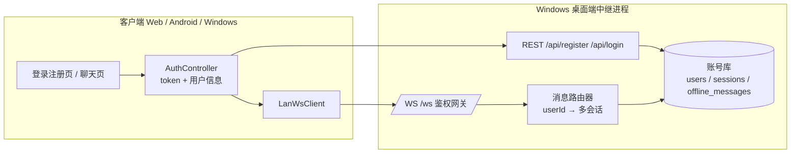
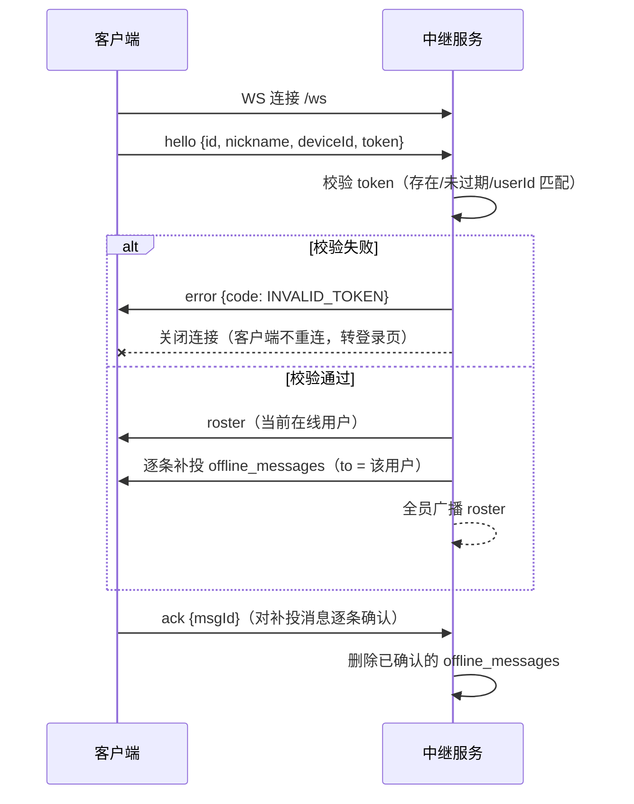

# 用户系统设计方案：注册登录 + 用户间实时对话

> 状态：待评审
> 关联代码：[message_envelope.dart](../lib/core/protocol/message_envelope.dart)、[host_server_io.dart](../lib/core/network/host_server_io.dart)、[ws_client.dart](../lib/core/network/ws_client.dart)、[connection_providers.dart](../lib/features/connection/connection_providers.dart)

## 1. 背景与目标

当前应用是「匿名设备」模型：客户端首次启动生成随机 `deviceId`，以 `{id, nickname}` 通过 `hello` 注册到桌面端内置中继，无任何鉴权，任何人连上 `ws://host:9090/ws` 即可收发消息。

本方案目标：

1. 引入**账号体系**：支持用户名 + 密码注册、登录，服务端持久化账号；
2. **WebSocket 接入鉴权**：未登录无法接入中继，`from` 身份由服务端按 token 反查，客户端不可伪造；
3. **按用户的会话**：会话对象从「设备」升级为「用户」，支持用户间定向实时对话（保留全员广播）；
4. **离线消息**：目标用户不在线时服务端暂存，上线后补投（解决已知限制「服务端无离线消息暂存」）；
5. 保持现有架构形态不变：中继仍内嵌于 Windows 桌面端进程，Web/Android 作为客户端接入。

不在本期范围：群聊、好友关系、头像/文件消息、公网部署（TLS）。

## 2. 现状要点（改造基础）

| 模块 | 现状 | 改造影响 |
|---|---|---|
| 协议 [message_envelope.dart](../lib/core/protocol/message_envelope.dart) | `MessageType{hello,roster,chat,ack,ping,pong,unknown}`，`from` 为 `DeviceProfile{id,nickname}` | 新增 `error` 类型；`DeviceProfile` → `UserProfile`；hello 增加 token 字段 |
| 服务端 [host_server_io.dart](../lib/core/network/host_server_io.dart) | shelf + shelf_web_socket，仅 `/ws` 路由，`_sessions` 以 deviceId 为键 | 增加 REST 路由（注册/登录）、WS 接入鉴权、按 userId 路由、离线暂存 |
| 客户端 [ws_client.dart](../lib/core/network/ws_client.dart) | 携带 deviceId/nickname 发 hello；msgId 去重、待发队列、重连补发 | hello 携带 token；鉴权失败上报错误状态（不再无限重连） |
| 连接流程 [connection_providers.dart](../lib/features/connection/connection_providers.dart) | 解析服务器地址 → 直连 WS | 前置登录/注册步骤（REST），成功后持 token 连接 |
| 聊天 [chat_providers.dart](../lib/features/chat/chat_providers.dart) | 会话按「对方 deviceId」划分，本地保留 200 条 | 会话键改为「对方 userId」，消息模型增加 username |
| 导航 [app.dart](../lib/app.dart) | 3 页 + ShellRoute，无守卫 | 新增登录/注册页 + `redirect` 路由守卫 |
| 持久化 | shared_preferences（昵称/地址/设备ID/聊天记录） | 新增 token/用户信息；服务端新增账号与离线消息存储 |

## 3. 总体架构



关键决策与理由：

1. **鉴权方式：Token（不透明随机令牌）而非 JWT**
   - 服务端本就持有会话表（需支持踢下线、多设备管理），不透明 token 天然支持服务端吊销，实现简单（`Random.secure` 生成 32 字节十六进制）；
   - 避免 JWT 引入签名密钥管理与过期刷新复杂度。
2. **账号存储：SQLite（`sqlite3` 包）**
   - 账号是长期数据且含密码哈希，不宜用 JSON 文件手写并发与原子性；
   - `sqlite3` 纯 Dart FFI，Windows 桌面端可直接使用；MVP 亦可先用 JSON 文件落地，接口层抽象 `AccountStore` 以便替换。
3. **多设备策略：一个账号多个在线会话（每会话一个 token）**
   - 消息路由按 userId 扇出到该用户全部在线会话；
   - 同一 `deviceId` 重复登录踢旧连接（复用现有 `_register` 踢旧逻辑）。
4. **REST 与 WS 同端口**：shelf `Pipeline` 加 `shelf_router`，`/api/*` 走 HTTP、`/ws` 走 WebSocket，地址发现逻辑（[server_resolver.dart](../lib/core/network/server_resolver.dart)）完全复用。

## 4. 数据模型（服务端）

```sql
-- 用户表
CREATE TABLE users (
  id            TEXT PRIMARY KEY,      -- uuid v4
  username      TEXT UNIQUE NOT NULL,  -- 登录名：3-24 位字母数字下划线
  nickname      TEXT NOT NULL,         -- 展示名，默认同 username
  password_hash TEXT NOT NULL,         -- PBKDF2-HMAC-SHA256(hex)
  salt          TEXT NOT NULL,         -- 16 字节随机盐(hex)
  created_at    INTEGER NOT NULL
);

-- 会话/令牌表
CREATE TABLE sessions (
  token      TEXT PRIMARY KEY,         -- 64 位 hex
  user_id    TEXT NOT NULL REFERENCES users(id),
  device_id  TEXT NOT NULL,
  created_at INTEGER NOT NULL,
  expires_at INTEGER NOT NULL          -- 默认 7 天，续期策略：登录时重置
);

-- 离线/未确认消息表（补投成功即删，不做全量历史）
CREATE TABLE offline_messages (
  msg_id     TEXT PRIMARY KEY,
  from_user  TEXT NOT NULL,
  to_user    TEXT NOT NULL,
  text       TEXT NOT NULL,
  timestamp  INTEGER NOT NULL
);
```

密码哈希：PBKDF2-HMAC-SHA256，迭代 ≥ 100,000 次，盐 16 字节（`pointy_castle` 提供 PBKDF2；避免自造哈希）。校验使用常量时间比较。

## 5. 协议扩展

### 5.1 REST API（`http://host:9090/api`）

| 方法 | 路径 | 请求体 | 成功响应 | 错误码 |
|---|---|---|---|---|
| POST | `/api/register` | `{username, password, nickname?}` | `{token, user:{id,username,nickname}}`（注册即登录） | `USERNAME_TAKEN` / `INVALID_USERNAME` / `WEAK_PASSWORD` |
| POST | `/api/login` | `{username, password, deviceId}` | `{token, user:{...}, expiresAt}` | `BAD_CREDENTIALS` |
| GET | `/api/me` | Header `Authorization: Bearer <token>` | `{user:{...}}` | `INVALID_TOKEN` |

错误统一为 `{error: {code, message}}`，HTTP 状态码 400/401/409。

### 5.2 WebSocket 消息（沿用 MessageEnvelope 信封）

```dart
enum MessageType {
  hello,   // 客户端→服务端：payload {id: userId, nickname, deviceId, token}
  roster,  // 服务端→全员：payload {users: [{id, username, nickname}]}（原 devices 键更名）
  chat,    // 不变，to = 目标 userId 或 '*'
  ack,     // 双向：服务端→发送方（确认接收）；客户端→服务端（确认离线补投已落盘）
  ping, pong,   // 不变
  error,   // 新增：服务端→客户端 payload {code, message}，随后服务端主动关闭
  unknown,
}
```

接入握手流程：



要点：

- `from` 字段由服务端覆盖为账号资料，客户端不可伪造身份（现有 `_forwardChat` 已做此覆盖，保留）；
- 鉴权失败时客户端收到 `error` 后**停止自动重连**（[ws_client.dart](../lib/core/network/ws_client.dart) 需新增「不可恢复错误」终态，如 `LanConnPhase.authFailed`）；
- `ack` 语义扩展为双向：补投消息以客户端 ack 作为「已送达且已持久化」凭证后删除。

## 6. 服务端改造（[host_server_io.dart](../lib/core/network/host_server_io.dart)）

```
HostServer
├── AccountStore（新，接口）
│     ├── register(username, password, nickname) → User
│     ├── verifyLogin(username, password, deviceId) → Session
│     ├── validateToken(token, userId) → Session?
│     └──（离线消息）enqueueOffline / takeOffline(userId) / confirmOffline(msgId)
├── SqliteAccountStore（sqlite3 实现）        ┐ MVP 任选其一，
└── JsonFileAccountStore（临时实现，data/ 目录）┘ 接口先行
```

- `_sessions` 键从 deviceId 改为 **token**（一个会话一条），`_Session` 持有 `UserProfile`；路由时按 userId 过滤出全部在线会话扇出；
- `_register`：校验 token 失败 → 回 `error` 并关闭；成功 → 踢同 deviceId 旧会话、补投离线消息、广播 roster；
- `_forwardChat`：`to` 为 userId；目标用户无在线会话时写入 `offline_messages`（仍先 ack 发送方，保证发送方 UI 状态正确）；
- 配置项：`allowRegistration`（默认开）、token 有效期、端口复用现有 [constants.dart](../lib/core/constants.dart)。

## 7. 客户端改造

### 7.1 新增 Auth 模块（`lib/features/auth/`）

```
auth/
├── auth_api.dart          # AuthApi：register/login/me（http 包，复用已解析的服务器地址）
├── auth_providers.dart    # AuthController(AsyncNotifier<AuthState>)
│                          #   AuthState {phase: loggedOut/submitting/loggedIn, user, token, error?}
│                          #   登录成功持久化 token+user（shared_preferences）
│                          #   token 过期/WS authFailed → 登出并清空
├── login_page.dart
└── register_page.dart     # 表单校验：用户名 3-24 位、密码 ≥ 8 位
```

### 7.2 连接与路由整合

- 新流程：`自动发现服务器地址（复用 autoResolveAddress）→ 未登录跳登录页 → 登录成功 → 持 token 连接 WS → 聊天页`；
- [app.dart](../lib/app.dart) 增加 `GoRouter.redirect`：`AuthState.loggedOut` 时访问 `/chat`、`/settings`、`/connect` 一律重定向 `/login`；`loggedIn` 时访问 `/login`、`/register` 重定向 `/connect`；
- [ws_client.dart](../lib/core/network/ws_client.dart)：hello 增加 token；新增 `authFailed` 终态（收到 `error(INVALID_TOKEN)` 即进入，不再退避重连）；
- [connection_providers.dart](../lib/features/connection/connection_providers.dart)：`connect()` 从 AuthState 读取 token；`deviceIdProvider` 保留，作为多设备会话标识；
- [chat_providers.dart](../lib/features/chat/chat_providers.dart)：会话键改 userId；`ChatMessage` 增加 `senderUsername`；收到 `error` 类型消息时全局提示。

### 7.3 移除/降级的旧概念

- `nicknameProvider` 降级为「账号昵称」的本地缓存（登录后从 `/api/me` 同步，改昵称走服务端接口——本期可只读，改名接口列为后续项）；
- 匿名模式移除：无账号不能进入聊天。

## 8. 安全设计

| 项 | 措施 |
|---|---|
| 密码存储 | PBKDF2-HMAC-SHA256 ≥100k 迭代 + 随机盐，服务端只存哈希 |
| 传输 | 局域网 `ws://`/`http://` 明文（与现状一致，方案定位仍为可信局域网）；公网部署需 TLS，列为后续项 |
| 身份伪造 | `from` 服务端强制覆盖；token 仅存服务端 sessions 表 |
| token 客户端存储 | MVP 用 shared_preferences（明文）；增强项：`flutter_secure_storage`（接口层已隔离，可后换） |
| 暴力破解 | 登录接口按 IP + 用户名做简单限速（如 5 次/分钟，内存计数即可） |
| 注册开关 | `allowRegistration` 配置，防止局域网内任意注册 |

## 9. 测试计划

沿用现有分层（纯 Dart 单测 + 集成测试），全部落 `test/`：

1. **协议单测**（扩展 [message_envelope_test.dart](../test/message_envelope_test.dart)）：`error` 类型编解码、roster users 字段、hello token 字段；
2. **账号逻辑单测**（新 `auth_store_test.dart`）：注册重名、登录成功/失败、token 过期、离线消息入队/补投/确认删除（临时目录文件或内存 sqlite）；
3. **集成测试**（扩展 [lan_network_integration_test.dart](../test/lan_network_integration_test.dart) 风格）：
   - 注册 → 登录 → 双用户 WS 互发定向消息；
   - 目标离线发消息 → 目标上线收到补投 → ack 后服务端清除；
   - 错误 token 连接被拒并收到 `error`；
   - 同 deviceId 重复登录踢旧会话；
4. **回归**：现有 16 个单测适配后全绿；`flutter analyze` 0 warning。

## 10. 分阶段实施

| 阶段 | 内容 | 验收标准 |
|---|---|---|
| ① 协议与模型 | `UserProfile`、`error` 类型、hello token、roster users 字段；`AccountStore` 接口 + JsonFile 实现；PBKDF2 工具 | 协议单测通过，旧字段兼容处理完成 |
| ② 服务端鉴权 | shelf_router 挂载 REST；WS 握手校验；按 userId 路由与扇出；离线暂存/补投/确认 | 服务端集成测试通过（脚本模拟双客户端） |
| ③ 客户端认证 | AuthApi/AuthController、登录/注册页、路由守卫、ws_client authFailed 终态 | Web 端注册→登录→连接全流程走通 |
| ④ 会话与离线 | 会话键改 userId、离线补投 UI（含 ack 回执） | 双端互发 + 离线补投在真机验证 |
| ⑤ 全量验证 | 回归测试、三端构建（Web/Windows/Android） | analyze 0 warning，测试全绿，三端产物可运行 |

## 11. 风险与后续项

- **单点与数据迁移**：账号绑定宿主机文件，换机需拷贝数据目录；多实例/云部署需引入独立服务端与外部 DB（超出本期）。
- **历史消息**：本期仅离线补投（送达即删）；全量服务端历史 + 多端漫游列为后续项（表结构已预留扩展位）。
- **改昵称/改密码接口**：本期不做，REST 结构已预留。
- **群聊、好友关系**：消息模型 `to` 已支持任意目标，群聊只需引入 groupId 与成员表，为后续自然扩展。

## 12. 后续开发计划（阶段⑤–⑨）

> 2026-10-21 追加。原阶段①–④（协议与模型、服务端鉴权、客户端认证、按用户会话+离线补投）已全部落地并通过 79 项测试；原「⑤ 全量验证」顺延为阶段⑨。阶段⑤「登录即连接」与阶段⑥「离线消息提示与未读体系」、阶段⑦「消息可靠性补全」已完成（95 项测试全绿）；实施说明：补投 payload 以 `replay: true` 标记，未读随会话持久化（`pref.chat.unread`），`ChatSendStatus` 增加 `failed` 终态（重连放弃后标红、点击重试），服务端对鉴权未完成期间的 chat 消息先缓冲后转发（防止补发丢失），系统通知（flutter_local_notifications）暂缓。阶段⑧「体验与安全补全」已完成（98 项测试全绿）；实施说明：新增 `/api/nickname`、`/api/password`（改密成功吊销其他设备会话、当前 token 保留），登录失败按「IP|用户名」内存计数限速（60 秒窗口 ≥5 次返回 429 `TOO_MANY_ATTEMPTS`，成功清零），设置页新增改昵称/改密码入口，会话列表独立页面化 `/chats`（未读角标 + 最近消息预览，替代横向选择条），`flutter_secure_storage` 可选项暂缓。

### 阶段⑤：登录即连接（打通「登录 → 聊天」自动化链路）

现状痛点：登录成功后仍需在连接页手动点连接；启动恢复 token 时不校验有效性，死 token 要等 WS `authFailed` 才发现。

1. **启动恢复校验**：`_restore()` 恢复 token 后异步调 `/api/me` 校验（已保存服务器地址时），`INVALID_TOKEN` 即清会话转登录页；网络不可达时保持乐观恢复，由连接层兜底重试。
2. **登录成功自动连接**：`ConnectionController` 监听认证状态，从未登录变为已登录（登录/注册成功、启动恢复）且未连接时自动执行「地址解析（复用 `autoResolveAddress`）→ `connect()`」；启动路由初始页改为 `/chat`，连接过程在消息页空态可见。
3. **连接页降级为状态页**：移除进入页面即自动探测的旧逻辑，保留「自动检测并连接」按钮与手动改地址/重连能力；自动连接失败时展示原因。
4. **消息页空态升级**：展示连接阶段（连接中/重连中/失败原因）并提供「去连接」入口，替代静态引导文案。
5. **踢下线闭环**：`authFailed → onAuthFailed → 登录页 → 重新登录 → 自动重连`，无需手动重连。

验收标准：恢复的无效 token 启动即登出；登录成功后无需任何手动操作自动连上中继并进入消息页；连接失败有明确提示与重试路径。

### 阶段⑥：离线消息提示与未读体系

现状痛点：离线补投的消息静默落进会话，无任何提示；会话切换无未读角标。

1. **协议标记**：服务端 `_replayOffline` 补投时在 payload 加 `'replay': true`，客户端据此区分实时/补投消息（沿用 MessageEnvelope，向后兼容）。
2. **未读计数**：`ChatUiState` 增加 `unread: Map<String, int>`——消息归属会话 ≠ 当前会话时 +1，切会话清零，随会话持久化。
3. **UI 提示**：会话选择器加未读角标；补投消息在会话内显示「以下是离线消息」分隔线；不在消息页时 SnackBar 提示「收到 N 条离线消息」。
4. **系统通知（可选二档）**：桌面/Android 用 `flutter_local_notifications`（仅后台 + 非当前会话触发）；Web 端 Notification API 后做。

### 阶段⑦：消息可靠性补全（小而关键）

已知缺陷：`ChatController.send()` 在未连接时直接 return，用户输入的消息被丢弃——而 `LanWsClient.enqueue` 本身支持断线入队、重连补发。

1. 未连接时也构造 envelope 入待发队列，UI 显示「发送中」，重连后自动补发转「已送达」。
2. 补「发送失败」终态（重连上限后标红 + 点击重试），可选。

### 阶段⑧：体验与安全补全（第 11 节后续项）✅ 已完成

- ✅ 改昵称/改密码 REST 接口 + 设置页入口
- ✅ 服务端登录接口限速（IP + 用户名内存计数，60 秒窗口 5 次）
- ⏸ token 迁移 `flutter_secure_storage`（可选，暂缓）
- ✅ 会话列表独立页面化（`/chats`，未读角标 + 最近消息预览，替代横向选择条）

### 阶段⑨：全量验证（原阶段⑤）

`flutter analyze` 0 warning、全部测试绿、三端构建产物（Web/Windows/Android）可运行，真机验证双端互发 + 离线补投。

> 2026-10-21 进展：analyze 0 告警、98 项测试全绿；三端构建产物已产出——Web `build/web`、Windows `build/windows/x64/runner/Release/flutter_template.exe`、Android `build/app/outputs/flutter-apk/app-release.apk`（51.2MB，release 用 debug 签名）。构建注意：沙箱环境会拦截 Gradle 对 pub 缓存中 `jni` 插件 `.cxx` 目录与 Android SDK `.knownPackages` 的写入，需在沙箱外执行 `flutter build apk`。真机双端互发 + 离线补投验证待人工执行。

### 阶段 R1/R2：安全加固（架构风险报告 P0 项）

> 2026-10-22 完成：
>
> **R2 PBKDF2 阻塞**：`PasswordHasher.hash/verify` 改为 `Isolate.run` 后台执行（返回 Future），10 万次迭代不再阻塞事件循环（服务端并发登录/注册时 WS 心跳与转发不受影响）；`AccountStore.register/verifyLogin/changePassword` 调用点与相关测试同步适配 await，`deriveHex`（RFC 向量）保持同步。
>
> **R1 明文传输（WSS/HTTPS + 自签证书 + 客户端自动回退）**：
> - 新增 `core/network/relay_cert.dart`（pointycastle）：首次启动生成 RSA-2048 自签证书（CN=LAN Messenger Relay，有效期 10 年，随机序列号，basicConstraints CA:true；TBS/SPKI/PKCS#8 全部 DER 手工拼装），`relay-cert.pem` / `relay-key.pem` 以「临时文件 + rename」原子落盘于应用数据目录，幂等复用；
> - `HostServer.start` 新增可选 `SecurityContext`（shelf_io 以 TLS 监听）；桌面启动装配证书上下文，生成/加载失败降级为明文（可用性优先）；`RelayStatus` 增加 `secure` 标记，连接页展示 TLS 状态；
> - 服务探测改为**先 TLS 后明文**（`probeServer` → `ProbeResult{reachable, secure}`，防止把 TLS 服务误判为明文可达）：IO 用 `SecureSocket.connect`（onBadCertificate 接受自签），Web 用 fetch `/api/me` 近似探测（https 优先，任何响应含 401 均算可达）；
> - `ResolvedServer` 增加 `secure`；持久化新增 `pref.server_secure`；WS 连接与 autoConnect 按标记选 wss/ws，REST（register/login/me/nickname/password）按 secure 选 https/http，https 使用接受自签证书的 `IOClient`；
> - `LanWsClient` 默认连接器经 `tls_support.dart` 条件导入：IO 端 wss 用 `IOWebSocketChannel.connect(customClient:)`（badCertificateCallback 接受自签），Web 端证书信任由浏览器策略管理，无法代码内绕过（连接页提示：Web 首次使用需先用浏览器访问一次中继地址并信任证书）；
> - 新增 `test/relay_tls_test.dart` 5 项：证书生成幂等且 PEM 可被 SecurityContext 加载、TLS 端口 secure 探测命中、https REST 注册/登录/me 闭环、wss 生产连接器双端握手 + roster 闭环、明文服务探测 secure=false 不误判。
>
> 全量：analyze 0 告警，104 项测试全绿。经验：条件导出门面在分析器下可能解析到 stub，io-only 文件（desktop_bootstrap_io）直接导入具体实现；auth_session_test 的 roster 断言存在事件循环竞争（connected 状态观察与 roster 帧处理间无顺序保证），改为 waitFor 轮询。

### 阶段 R3/R4：可靠性与令牌安全（架构风险报告 P1 项）

> 2026-10-22 完成：
>
> **R3 重连永不放弃**：
> - `LanWsClient` 退避耗尽（`BackoffStrategy.delayFor` 返回 null）不再进入 `disconnected` 终态，改转 `slowPollInterval`（60s）慢速轮询：保持 `reconnecting` 阶段、按周期重试建连，中继恢复后客户端在下一轮询周期内自动自愈；
> - `LanConnState` 新增 `slowPolling` 标记，连接页/消息页空态区分文案：「连接断开，Xs 后重连…」（快速退避）vs「连接中断，每 60s 自动重连，恢复后无需手动操作」（慢速轮询）；
> - 聊天层语义适配：慢速轮询期间消息保持「发送中」等待补发（不标记失败）；`ChatController._onConnState` 改为仅在客户端进入 `disconnected`（主动断开、实例替换）时把发送中消息标记为失败，用户可点击重试；
> - `chat_flow_test` 阶段⑦改写：退避耗尽 → 慢速轮询且消息保持发送中 → 实例替换标记失败 → retryMessage 重新入队 → 恢复连接后补发并转已送达。
>
> **R4 token 摘要落盘 + 客户端安全存储**：
> - 服务端：`sessions.json` 只存 `SHA-256(token)` 摘要（键与 `AuthSession.token` 均为摘要），校验时对来方明文 token 做同样摘要后比对；`verifyLogin` 返回值是唯一携带明文 token 的会话（下发给客户端仅此一次）；离线补投、多设备踢出、改密吊销均按摘要键控，行为不变。注意：升级后旧版明文 sessions.json 条目（摘要与明文同为 64 位 hex、无法区分）将校验失败，存量用户需重新登录一次；
> - 客户端：新增 `core/auth/token_store.dart` 条件门面 + `token_store_base.dart`（`TokenStore` 接口与 `InMemoryTokenStore` 测试实现）+ `token_store_secure.dart`（IO：flutter_secure_storage，Windows DPAPI / Android Keystore，首次读取自动迁移旧版 shared_preferences 明文副本并删除）+ `token_store_prefs.dart`（Web：localStorage，键名沿用、存量会话免迁移）；账号资料（user_id/username/nickname，非敏感）仍存 shared_preferences；
> - `auth_providers` 经 `tokenStoreProvider`（可覆写）读写 token：`_restore` 读取（平台通道异常按无会话处理）、`_applySession` 写入、`_clearSession` 删除；
> - 测试适配：`account_store_test` 增加「sessions.json 不含明文 token、含摘要」断言；`auth_session_test` / `app_test` 以 `InMemoryTokenStore` 覆写注入（FakeAsync 下 secure_storage 平台通道永不完成，必须覆写）。
>
> 全量：analyze 0 告警，105 项测试全绿。

实施顺序：⑤ → ⑥ 优先（对应「登录即连接」「离线提示」两个核心诉求），⑦ 可与 ⑥ 同批实施（同在 chat 层）。
